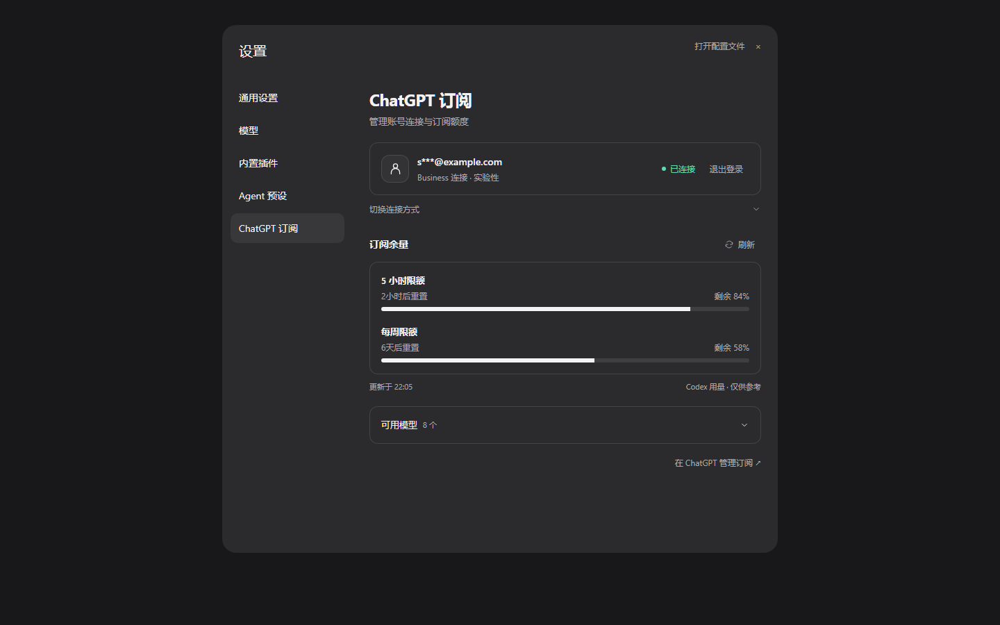

<p align="center">
  
</p>

<h1 align="center">ChatGPT Pass</h1>

<p align="center">
  <strong>English</strong> · <a href="README.zh-CN.md">简体中文</a>
</p>

Use authorized ChatGPT subscription models in DeepSeek Harness with `dsh-chatgpt-pass`. This plugin provides account connections, a model catalog, streaming text, local function tools, and remaining subscription quota when available.

This is an independently maintained third-party plugin, not an official OpenAI or DeepSeek plugin. Validated Harness versions are **0.2.1-rc.5** and **0.2.2-rc.1**. Other versions have not been verified.

## Installation

Download `dsh-chatgpt-pass-<version>.tgz` and its `.sha256` file from [Releases](https://github.com/isjya/dsh-chatgpt-pass/releases). Add the local package in the Harness plugin manager and enable it. Release packages are prebuilt; users do not need to install Node.js separately, clone the source, or run build scripts.

Current package: [v0.2.18](https://github.com/isjya/dsh-chatgpt-pass/releases/download/v0.2.18/dsh-chatgpt-pass-0.2.18.tgz). If your plugin manager accepts download links, you can paste this `.tgz` URL directly. This project is distributed through GitHub Releases and is not currently published on npm.

For CLI installation, replace the profile and filename with your actual values:

```sh
dsh plugin --profile <profile> add ./dsh-chatgpt-pass-<version>.tgz
```

See the [installation guide (Chinese)](docs/INSTALL.md) for installation, upgrades, removal, and compatibility details.

## Preview



The account and quota shown above are demonstration data. The settings page currently uses Chinese labels; their English meanings are provided below.

## Sign in and use models

Open **Settings → ChatGPT 订阅 (ChatGPT Subscription)** and choose a connection:

| Entry | Recommended accounts | Connection |
| --- | --- | --- |
| ChatGPT 登录 (ChatGPT login) | Plus / Pro | Official Sign in with ChatGPT (SIWC) flow |
| Business 登录 (Business login) | Business / Team | Experimental Codex compatibility route |

Complete authorization on the official browser page, return to Harness, and choose an available model in the chat model picker. Once connected, expand **切换连接方式 (Switch connection method)** to sign in again, or **可用模型 (Available models)** to view and refresh the catalog.

Codex connections can show the remaining quota and reset countdown for five-hour and weekly windows. When the official connection does not provide quota data, the page shows an empty state rather than estimating usage. Account-wide historical token analytics are not currently available.

Enable **在侧边栏显示余量 (Show quota in sidebar)** to show only the five-hour remaining quota in a compact entry above the main sidebar's account/settings control. Click it to open a detail popover with five-hour and weekly limits, reset countdowns, refresh, and usage management. Click outside or press Escape to close. The option defaults to off, is saved in Harness configuration, updates about once a minute while visible, and hides when the sidebar collapses.

**The Business compatibility route is not a third-party integration supported by OpenAI's documentation.** It uses the first-party Codex OAuth client and may be affected by workspace policies, terms of service, or interface changes. Use only accounts and workspaces you are authorized to access. Eligibility, models, and actual limits depend on the authorization result.

## Development

Requires Node.js **≥24.9** and pnpm **11.28.5**:

```sh
pnpm install --frozen-lockfile --ignore-scripts
pnpm check
pnpm check:repository
pnpm pack:release
```

Build output and release packages are written to local `lib/` and `artifacts/` directories. The repository contains source, tests, and maintained documentation; prebuilt packages are distributed through Releases.

Further documentation:

- [Development and verification (Chinese)](docs/DEVELOPMENT.md)
- [Architecture and protocol boundaries (Chinese)](docs/ARCHITECTURE.md)
- [Release process (Chinese)](docs/RELEASING.md)
- [Third-party notices](THIRD_PARTY_NOTICES.md)

## Limitations and credentials

- Currently supports text and ordinary local function tools; full multimodal support is not guaranteed.
- Real Plus / Pro inference has not been verified. The Business compatibility route has been verified with real text and tool rounds. Automated tests do not establish account eligibility.
- Only one connection is active at a time. Switching methods requires signing in again and replaces the current connection.
- Credentials are stored by the Harness credentials service, not in plugin configuration, browser state, or distribution packages. The plugin does not read other applications' login caches or fall back to API-key billing.
- After signing out locally, you can manage remote authorization in [ChatGPT usage and permissions settings](https://chatgpt.com/settings/usage).

## License

[MIT](LICENSE). Find the project through GitHub's `dsh-plugin` topic.
