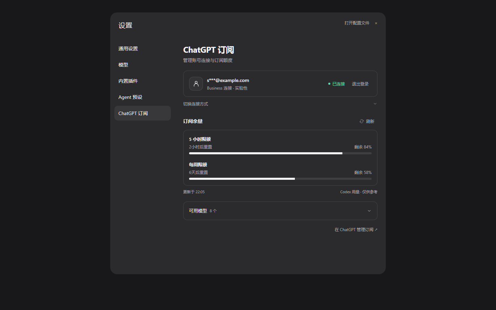

<p align="center">
  
</p>

<h1 align="center">ChatGPT Pass · 订阅通行证</h1>

<p align="center">
  <a href="README.md">English</a> · <strong>简体中文</strong>
</p>

`dsh-chatgpt-pass` 让 DeepSeek Harness 使用已授权的 ChatGPT 订阅模型。插件提供账号连接、模型目录、流式文本、本地函数工具，以及可用时的订阅剩余额度。

这是独立维护的第三方插件，并非 OpenAI 或 DeepSeek 官方插件。当前版本支持 Harness **0.2.1-rc.5** 与 **0.2.2-rc.1**，其他版本尚未验证。

## 安装

在 [Releases](https://github.com/isjya/dsh-chatgpt-pass/releases) 下载 `dsh-chatgpt-pass-<版本>.tgz` 和对应 `.sha256` 文件，然后在 Harness 的插件管理器中添加本地安装包并启用。安装包已经构建，用户无需单独安装 Node.js、下载源码或运行构建脚本。

当前安装包：[v0.2.16](https://github.com/isjya/dsh-chatgpt-pass/releases/download/v0.2.16/dsh-chatgpt-pass-0.2.16.tgz)。插件管理器支持链接输入时，也可粘贴该 `.tgz` 下载地址。本项目目前通过 GitHub Releases 分发，尚未发布到 npm。

使用 CLI 时，将命令中的文件名和 profile 替换为实际值：

```sh
dsh plugin --profile <profile> add ./dsh-chatgpt-pass-<版本>.tgz
```

完整安装、升级、卸载和兼容性说明见 [安装指南](docs/INSTALL.md)。

从本仓库 v0.2.14 及更早版本升级：先移除旧的 `dsh-chatgpt-provider` 插件，再安装新包并重启 Harness。迁移时不要点击「退出登录」，已有登录记录和模型标识会保留；不要同时启用新旧两个包。

## 界面示例



图中账号与用量为演示数据。

## 登录与使用

打开 **设置 → ChatGPT 订阅**，选择适合账号的连接方式：

| 入口 | 推荐账号 | 连接方式 |
| --- | --- | --- |
| ChatGPT 登录 | Plus / Pro | 官方 SIWC 授权流程 |
| Business 登录 | Business / Team | Codex 兼容路径，实验性 |

在官方浏览器授权页完成登录后，回到 Harness，在聊天模型选择器中选择实际返回的模型。已连接时，可展开「切换连接方式」重新登录，或展开「可用模型」查看和刷新目录。

Codex 连接可显示 5 小时与每周剩余额度及重置倒计时。官方连接没有此数据时显示空状态，不生成估算用量。当前不提供账号级历史 Token 分析。

**Business 兼容路径不属于 OpenAI 文档支持的第三方接入方式。** 它使用 Codex 第一方 OAuth 客户端，可能受工作区策略、服务条款及接口变动影响。只使用你获准使用的账号与工作区。账号资格、模型和实际限额以授权结果为准。

## 开发

需要 Node.js **≥24.9** 和 pnpm **11.28.5**：

```sh
pnpm install --frozen-lockfile --ignore-scripts
pnpm check
pnpm check:repository
pnpm pack:release
```

构建与打包结果写入本地 `lib/` 和 `artifacts/`。仓库只保存源码、测试和维护文档；用户通过 Releases 获取构建产物。

- [开发与验证](docs/DEVELOPMENT.md)
- [架构与协议边界](docs/ARCHITECTURE.md)
- [发布流程](docs/RELEASING.md)
- [第三方许可](THIRD_PARTY_NOTICES.md)

## 限制与凭据

- 当前声明文本与普通本地函数工具；未承诺完整多模态支持。
- Plus / Pro 的真实账号调用尚未验证；Business 兼容路径已完成真实文本和工具回合验证。自动化测试不代表真实账号资格。
- 一次只保持一条活动连接。切换入口会重新登录并替换当前连接。
- 凭据由 Harness 的 credentials 服务保存，不进入插件配置、浏览器状态或分发包。插件不会读取其他应用的登录缓存，也不会切换到 API key 计费。
- 退出登录后，可在 [ChatGPT 用量与权限设置](https://chatgpt.com/settings/usage) 管理远端授权。

## 许可证

[MIT](LICENSE)。项目可通过 GitHub 的 `dsh-plugin` 主题发现。
